# 14 — System Flow and Acceptance Test Cases

## 1. Purpose

This document provides a written end-to-end flow and a repeatable acceptance/regression test plan for the Procurement and Inventory Management System. It complements the detailed process and technical specifications; it does not replace them.

The test cases below are expected outcomes to verify in a test environment. The automated test suite covers many related behaviors, but the case list is not a claim that every step has a one-to-one automated test.

## 2. System flow

### 2.1 End-to-end flowchart

```mermaid
flowchart TD
    signIn[User signs in] --> access{Authorized for action and data scope?}
    access -- No --> denied[Access denied and attempt logged]
    access -- Yes --> setup[Maintain authorized organization, warehouse, supplier, and item data]
    setup --> need[Department or project identifies a requirement]
    need --> pr[Create and submit purchase requisition]
    pr --> prApproval{Approval engine decision}
    prApproval -- Returned --> correct[Correct and resubmit]
    correct --> prApproval
    prApproval -- Rejected or cancelled --> stopPR[Stop sourcing]
    prApproval -- Approved or partially approved --> source{Select sourcing route}

    source -- RFQ --> rfq[Issue RFQ to invited suppliers]
    source -- Standalone RFQ when policy permits --> rfq
    source -- Direct PO when policy permits --> poDraft[Create purchase order]
    rfq --> quotes[Capture and evaluate supplier quotations]
    quotes --> evalApproval{Approve recommended quotation?}
    evalApproval -- No --> stopRFQ[Reject or return evaluation]
    evalApproval -- Yes --> poDraft
    poDraft --> poApproval{Purchase order approved?}
    poApproval -- No --> revisePO[Return, reject, or cancel PO]
    poApproval -- Yes --> delivery[Supplier delivers goods]

    delivery --> sra[Create store receipt advice]
    sra --> verify[Verify delivered quantities and condition]
    verify --> inspection{Quality inspection required?}
    inspection -- Yes --> quality[Inspect and record accepted, rejected, and quarantined quantities]
    inspection -- No --> grn[Create eligible goods received note]
    quality --> grn
    grn --> posting[Post through InventoryPostingService]
    posting --> ledger[Append ledger and update balances, valuation, and tracking]

    ledger --> stock{Choose stock operation}
    stock -- Issue --> materialReq[Submit and approve material requisition]
    materialReq --> reserve[Reserve available quantity]
    reserve --> backorder{Shortage?}
    backorder -- Yes --> backorderRecord[Record backorder for uncovered quantity]
    backorder -- No --> issue[Post stock issue]
    backorderRecord --> replenished[Wait until stock is available or replenished]
    replenished --> issue
    issue --> acknowledge[Recipient acknowledges issue]

    stock -- Transfer --> transferApproval[Approve inter-warehouse transfer]
    transferApproval --> dispatch[Dispatch to in-transit stock]
    dispatch --> receive[Receive at destination and resolve discrepancies]
    receive --> transferComplete[Complete when dispatched quantity is accounted for]

    stock -- Return --> returnAssess[Assess project or department return]
    returnAssess --> condition{Accepted and good condition?}
    condition -- Yes --> returnToStock[Post return to available stock]
    condition -- No --> quarantine[Post to quarantine or repair holding]
    stock -- Supplier return --> supplierReturn[Validate against receipt and available quantity]
    supplierReturn --> posting

    stock -- Adjustment --> adjustmentApproval{Approval threshold met?}
    adjustmentApproval -- Yes --> adjustReview[Approve by a different authorized user]
    adjustmentApproval -- No --> adjustPost[Post authorized adjustment]
    adjustReview --> adjustPost
    adjustPost --> posting

    stock -- Stock count --> count[Snapshot, count, recount, and analyze variance]
    count --> countAdjust[Approve and post variance adjustments]
    countAdjust --> reconciliation[Prepare and separately approve reconciliation]
    reconciliation --> ledger

    ledger --> reports[Permission-scoped dashboard, reports, exports, and audit history]
    acknowledge --> reports
    transferComplete --> reports
    returnToStock --> reports
    quarantine --> reports
```



### 2.2 Written flow

1. **Authenticate and establish access**
   - A user signs in and receives access according to their active role, permissions, business-unit scope, project membership, and warehouse grants.
   - The system uses these permissions and scopes to control navigation, document actions, reports, and data returned by queries.

2. **Configure operational master data**
   - Administrators maintain business units, departments, cost centres, projects, warehouses, locations/bins, catalogue items, units of measure, suppliers, roles, approval flows, settings, and document-number sequences.
   - Master records used by posted documents are retired or deactivated rather than removed from history.

3. **Raise and approve demand**
   - An authorized requester creates a purchase requisition (PR) with the business unit, department/project, required date, justification, and item quantities. The business unit is retained on the PR because it is not yet bound to a destination warehouse.
   - Submitting the PR invokes the configured approval flow. Approvers may approve, partially approve, reject, or return it for correction. The creator cannot approve their own document when segregation of duties applies.

4. **Source the requirement**
   - Procurement creates an RFQ from the unconverted balance of an approved PR, or creates a standalone RFQ when policy allows.
   - The RFQ is issued to invited suppliers. Invited suppliers' quotations are captured and submitted; duplicate quotations for the same RFQ/supplier are rejected.
   - Procurement evaluates quotations using configured technical/commercial criteria and submits the recommendation for approval. Approval awards the recommended quotation and rejects the alternatives.

5. **Create and approve the purchase order**
   - Procurement creates a PO from an accepted quotation or an approved/partially approved PR. Unsourced POs are blocked unless explicitly enabled by policy.
   - The PO is submitted to its configured approval flow. Approved POs become eligible for delivery and receiving. Amendments are numbered, reviewed, and approved before changing the PO; amendments cannot reduce a line below quantities already received.

6. **Receive and inspect deliveries**
   - For an approved PO, warehouse staff create a Store Receipt Advice (SRA) for the delivered quantities.
   - Delivery verification records physical quantities and condition. Items requiring inspection cannot proceed to a postable GRN until inspection is completed.
   - Inspection records accepted, rejected, and quarantined quantities. The GRN records the accepted receipt and required batch/serial details.

7. **Post stock through the inventory engine**
   - Posting a GRN calls the central `InventoryPostingService`. Only accepted quantities enter an available stock dimension; rejected or quarantined quantities do not become available.
   - The service validates authorization, source state, tracking data, warehouse dimensions, availability, and idempotency. In one database transaction it writes the stock transaction and append-only ledger, updates balance projections and valuation/tracking data, and emits the inventory outbox event.
   - A retry with the same idempotency key returns the existing posting rather than duplicating stock. Corrections use compensating reversal entries; posted ledger rows are not edited.

8. **Reserve and issue stock**
   - A material requisition records the requesting department/project, destination warehouse, purpose, and item quantities. Its approval flow may approve the request fully or partially.
   - Warehouse staff reserve available stock. Any shortage remains visible as a backorder; reservations reduce available quantity without changing on-hand quantity.
   - A Store Issue Voucher can consume only the reservation. Posting decreases on-hand and reserved quantities. The recipient acknowledges the issue before it is closed.

9. **Move, return, or adjust stock**
   - An approved inter-warehouse transfer is dispatched from the source warehouse into an in-transit dimension, then received at the destination. Partial dispatch/receipt is supported; discrepancies remain unresolved until recorded and resolved.
   - Project/department returns reference an original issue and require a condition assessment. Accepted good material may return to available stock; damaged or quarantined material remains unavailable. Supplier returns follow their separate receiving-domain flow and cannot exceed eligible available stock.
   - Stock adjustments record a reason and signed quantity change. Adjustments at/above the configured threshold require approval, and the poster cannot approve/post their own adjustment where segregation of duties applies.

10. **Count and reconcile**
    - A full, cycle, or blind count captures a quantity snapshot and ledger watermark. Counters record physical quantities; recounts and variance analysis account for movements posted after the snapshot.
    - Authorized users create adjustments for approved variances. A separate reconciliation verifies that the snapshot, later movements, and posted adjustments reconcile to the ledger. A count is completed only after reconciliation is prepared, approved, and posted.

11. **Review and audit**
    - Authorized users review permission-scoped inventory, procurement, warehouse, project, and audit reports; filter and export results; and review dashboard KPIs and stock movement trends.
    - Document history, approval actions, posting transactions, reversals, and activity records remain available for audit.

## 3. Test environment and common setup

- Run tests against an isolated test database with migrations and the standard permission, role, settings, sequence, and approval-flow seed data.
- Prepare separate users for requester, procurement officer/manager, warehouse/store officer, quality inspector, approver, auditor, and a user without the permission under test.
- Prepare two business units and at least two warehouses. Grant the operational user access to only one warehouse to verify data scoping.
- Prepare active and inactive suppliers, items with no tracking, batch tracking, and serial tracking, and an item with inspection enabled.
- Use a seeded approval flow with at least two stages, a self-approval restriction, and an amount threshold. Use small and large test documents to exercise both sides of the threshold.
- Use disposable test data. Do not post test transactions or send test notifications using production records or credentials.

## 4. Acceptance test cases

| ID | Area | Steps | Expected result |
|---|---|---|---|
| SEC-01 | Authentication | Sign in with a valid active user, open an authorized page, then sign out. | The session is established for the authenticated user; signing out ends access to protected pages. |
| SEC-02 | Authentication | Attempt sign-in with an incorrect password and then with an inactive account. | Authentication is denied and no protected session is created. |
| SEC-03 | Permissions | Sign in as a user without a module permission and request the module URL directly. | The server denies the request; hiding a navigation link alone is not treated as authorization. |
| ORG-01 | Organization | Create a business unit, department, cost centre, and project; attempt to deactivate a business unit with an active warehouse and a department with an active project. | Valid records receive unique immutable codes; deactivation that violates dependency rules is blocked with an actionable validation error. |
| WH-01 | Warehouse access | Sign in as a user with access to one warehouse and open lists/details and perform an operation against a second warehouse. | Lists and reports contain only authorized warehouse data; direct access or writes against the second warehouse are denied. |
| CAT-01 | Catalogue | Create an item with a duplicate code, then create batch- and serial-tracked items and attempt a transaction without required tracking details. | Duplicate codes and incomplete tracking data are rejected; valid catalogue items retain their configured tracking and valuation rules. |
| SUP-01 | Supplier | Register a supplier, try to award a PO before approval, then approve it as a different authorized user and suspend it. | Unapproved/suspended suppliers cannot receive new awards; approval and status changes are permission-gated and audited. |
| WF-01 | Approvals | Submit a document through a multi-stage flow; try self-approval, approve once, then complete the remaining stage. | Self-approval and duplicate votes are rejected; stage progress and final document status follow the configured approval mode and history is retained. |
| WF-02 | Approvals | Return a document with a comment, edit and resubmit it; test a rejected document and an assigned delegate. | Return preserves prior actions and permits correction/resubmission; rejection terminates the request; active delegates can act within scope and actions identify the delegate. |
| PR-01 | Procurement | Create a PR with multiple lines and submit it for approval. | The PR receives a unique document number and enters the configured approval flow; unauthorized edits after submission are blocked. |
| PR-02 | Procurement | Partially approve a PR line, then attempt to source more than the remaining approved quantity and cancel a draft sourcing document. | Approved quantities and approved amount are recalculated; sourcing cannot exceed the approved balance; cancellation releases reserved sourcing quantity. |
| RFQ-01 | Procurement | Create an RFQ from approved PR quantity, issue it to selected suppliers, and submit a quotation from an invited and a non-invited supplier. | The RFQ accepts quotations only in an eligible state and from invited suppliers; a supplier cannot submit a duplicate quotation for the same RFQ. |
| QUO-01 | Procurement | Enter quotation quantity, unit price, tax, and discount values, then evaluate the quotation. | Totals use fixed-precision decimal arithmetic; weighted evaluation records scores and the recommended quotation. |
| EVAL-01 | Procurement | Submit the recommended quotation for approval and approve it. | The recommended quotation becomes accepted, alternatives are rejected, and the RFQ becomes awarded only after approval. |
| PO-01 | Procurement | Create a PO from an accepted quotation and separately try an unsourced PO with unsourced purchasing disabled. | A valid PO copies the accepted source and supplier; unsourced creation is blocked by default; approval is required before receiving. |
| PO-02 | Procurement | Receive part of a PO, create an amendment that keeps received quantity valid, then try an amendment below received quantity. | The valid amendment is versioned and applied only after approval; an amendment below received quantity is rejected. |
| RCV-01 | Receiving | Create an SRA against an approved PO, verify delivered quantities, and try to verify above delivered/SRA/PO open quantities. | Valid quantities progress to verified; quantities beyond the applicable limits are rejected and discrepancies are recorded. |
| QA-01 | Quality | For an inspection-required item, try to create/post a GRN before inspection; then record accepted, rejected, and quarantined quantities. | GRN posting is blocked until inspection reaches an eligible result; the accepted/rejected/quarantined split is validated and preserved. |
| GRN-01 | Receiving/Inventory | Post an eligible GRN with accepted quantity and required batch/serial details; retry the posting. | Only accepted quantity reaches available stock; ledger and balances update once; the retry does not duplicate the posting. |
| SRET-01 | Supplier returns | Create a supplier return against a receipt and attempt to return more than eligible available stock; then post a valid return. | Excess return is rejected; valid posting reduces stock through the central inventory posting service and remains auditable. |
| INV-01 | Inventory | Post an inbound transaction and an outbound transaction with valid source documents and tracking details. | Ledger entries are append-only; on-hand, available quantity, and valuation update consistently with the configured valuation method. |
| INV-02 | Inventory | Attempt an outbound posting exceeding available stock, then retry with a valid amount. | The excessive posting is rejected without partial writes or negative balance; the valid posting succeeds. |
| INV-03 | Inventory | Submit the same idempotency key twice, then reverse the posted transaction and inspect its original ledger rows. | The duplicate returns the original posting; reversal adds equal/opposite entries and links the original without editing or deleting ledger rows. |
| INV-04 | Reservations | Reserve available stock, attempt to over-reserve, then release, expire, and consume reservations through an issue. | Reservations do not change on-hand; availability reflects outstanding reservations; invalid amounts fail and lifecycle transitions update reserved quantities correctly. |
| DIST-01 | Distribution | Submit a material requisition, partially approve it, reserve available stock, and review the uncovered quantity. | Approval quantities are applied per line; reservation is limited to available stock and the shortfall is recorded as a backorder. |
| DIST-02 | Distribution | Create and post an issue for a reserved requisition; attempt to issue above the reservation and acknowledge as the issuer instead of the recipient. | Issue quantity cannot exceed reservation; posting consumes reservation; only the recipient can acknowledge unless an audited override applies. |
| DIST-03 | Transfers | Approve a transfer, partially dispatch, partially receive, and record a shortage or damage discrepancy. | Dispatched quantity moves to in-transit; receipts cannot exceed dispatched quantity; discrepancies remain pending until resolved and the transfer completes only when accounted for. |
| RET-01 | Returns | Return issued material with good and damaged conditions; attempt to post without assessment or with an invalid accepted/rejected split. | Assessment is mandatory; only accepted good material returns to available stock; damaged/quarantined material remains unavailable. |
| ADJ-01 | Stock control | Submit below- and above-threshold adjustments, try creator approval/posting, then post and reverse through a different authorized user. | Threshold rules determine approval; segregation-of-duties checks are enforced; reversal is a separate compensating document. |
| COUNT-01 | Stocktaking | Start a blind count, verify system quantities are hidden, record a count, post a movement after the snapshot, and recount. | Blind mode hides system quantity/variance while counting; expected quantity includes post-snapshot ledger movements; recount history is retained. |
| REC-01 | Reconciliation | Analyze count variances, create/post the required adjustments, then prepare and approve reconciliation as different users. | Reconciliation proves snapshot plus later movements plus posted adjustments equals the current ledger; the preparer cannot approve their own reconciliation. |
| REP-01 | Reporting | Run inventory, procurement, warehouse, project, and audit reports with a scoped user; filter and export one result. | Permission gates and data scopes are enforced; exported rows match the active report filters and accessible records. |
| DASH-01 | Dashboard | Open the dashboard as inventory-report viewers and non-viewers, including a user scoped to one warehouse. | KPI and six-month stock movement chart follow report permission and warehouse scope; empty data produces an empty state rather than invented values. |
| ADM-01 | Administration | Create a custom role, assign/revoke permissions, deactivate a user, and attempt to remove a protected system role. | Effective access changes immediately according to policy; protected roles and referenced records retain their integrity and audit history. |
| ADM-02 | Administration | Configure settings and document sequences; generate documents concurrently or repeat a generation request. | Sequence prefixes and numbering rules are applied without duplicate numbers; invalid settings are rejected and audited. |

## 5. Existing automated suite map

Run the full automated suite with:

```powershell
php artisan test
```

The current feature suite is organized by the following related areas:

| Area | Automated suite |
|---|---|
| Authentication and profile | [Auth tests](../tests/Feature/Auth), [ProfileTest.php](../tests/Feature/ProfileTest.php) |
| Administration | [Administration tests](../tests/Feature/Administration) |
| Organization and warehouse scope | [OrganizationScopeTest.php](../tests/Feature/Organization/OrganizationScopeTest.php), [WarehouseAccessTest.php](../tests/Feature/Warehouse/WarehouseAccessTest.php) |
| Suppliers and catalogue | [SupplierTest.php](../tests/Feature/Supplier/SupplierTest.php), [CatalogTest.php](../tests/Feature/Catalog/CatalogTest.php) |
| Approval engine | [Workflow tests](../tests/Feature/Workflow) |
| Procurement | [Procurement tests](../tests/Feature/Procurement) |
| Receiving | [ReceivingWorkflowTest.php](../tests/Feature/Receiving/ReceivingWorkflowTest.php) |
| Inventory | [Inventory tests](../tests/Feature/Inventory) |
| Distribution | [Distribution tests](../tests/Feature/Distribution) |
| Stocktaking | [Stocktaking tests](../tests/Feature/Stocktaking) |
| Reporting and dashboard | [Reporting tests](../tests/Feature/Reporting) |
| Application smoke checks | [ApplicationSmokeTest.php](../tests/Feature/ApplicationSmokeTest.php) |
